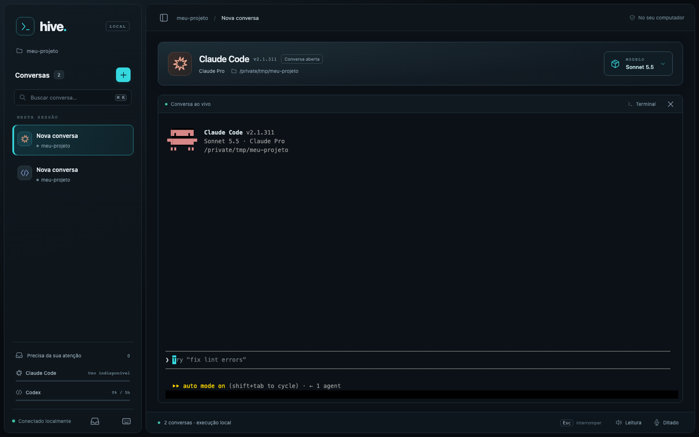
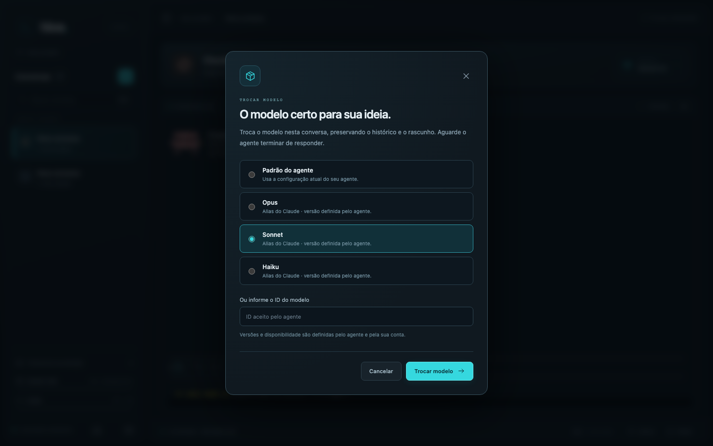
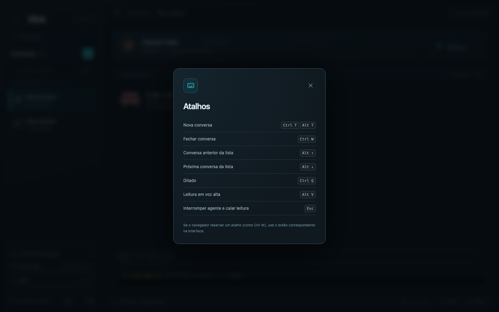

# hive-ui

Interface local para o [Claude Code](https://claude.com/claude-code) e o [Codex](https://github.com/openai/codex): uma janela própria com a lista de conversas ao lado, o terminal real de cada agente no centro, troca de modelo, ditado e leitura em voz alta. O visual e várias funções se inspiram no [workmux](https://github.com/raine/workmux).



- `hive` abre o aplicativo em uma janela própria, sem abrir o navegador.
- Cada conversa é um agente real (`claude` ou `codex`) rodando em sua própria sessão; trocar de conversa não reinicia nem interrompe as outras.
- Tudo roda no seu computador. A lista de conversas vive só na sessão: fechar a janela encerra os agentes.
- `hive --terminal` abre a mesma ideia dentro do terminal, com tmux. `claude` continua abrindo o Claude Code puro.

## Sumário

- [Instalação](#instalação)
- [Primeiro uso](#primeiro-uso)
- [Funcionalidades](#funcionalidades)
- [Atalhos](#atalhos)
- [Voz: leitura e ditado](#voz-leitura-e-ditado)
- [Modo terminal](#modo-terminal)
- [Os comandos `hive` e `claude`](#os-comandos-hive-e-claude)
- [Problemas comuns](#problemas-comuns)
- [Encerrar, atualizar e desinstalar](#encerrar-atualizar-e-desinstalar)
- [Como funciona](#como-funciona)
- [Desenvolvimento](#desenvolvimento)

## Instalação

### 1. Requisitos

- macOS ou Linux, com zsh ou bash
- [Node](https://nodejs.org) 22.12 ou mais novo
- Pelo menos um agente instalado e logado:
  - [Claude Code](https://claude.com/claude-code)
  - [Codex](https://github.com/openai/codex) (`npm i -g @openai/codex` e `codex login`)
- [tmux](https://github.com/tmux/tmux) 3.x: usado por trás de cada conversa e pelo [modo terminal](#modo-terminal)
- Opcional, só para o [ditado](#voz-leitura-e-ditado): um gravador de áudio. No macOS, `ffmpeg` ou `sox`; no Linux, `parec` (pulseaudio-utils), `pw-record` (pipewire), `arecord` (alsa-utils), `ffmpeg` ou `sox`.
- Só no Linux, para baixar os modelos de voz: `bzip2`.

Confira se estão no PATH:

```sh
node -v           # v22.12 ou maior
tmux -V           # tmux 3.x
claude --version  # e/ou: codex --version
```

No macOS, o que faltar sai pelo Homebrew: `brew install tmux node ffmpeg`.

### 2. Clone e instale

```sh
git clone https://github.com/ghts2110/hive-ui.git ~/hive-ui
cd ~/hive-ui && npm install && npm link
```

O `npm install` traz o Electron (a janela), o terminal integrado e o [sherpa-onnx](https://github.com/k2-fsa/sherpa-onnx), que roda a voz e o ditado localmente. Os modelos de voz só são baixados quando você liga cada função.

O `npm link` cria o comando `hive`. Abra um terminal novo e digite `hive`; não é preciso mexer no `~/.zshrc` (ou `~/.bashrc`).

### 3. Atualizar

O comando aponta para a pasta clonada:

```sh
cd ~/hive-ui && git pull && npm install
```

Com o nvm, o `hive` fica preso à versão do Node em que o `npm link` rodou: depois de `nvm use` em outra versão, rode `npm link` de novo na pasta.

**Vindo de uma versão antiga?** Antes a interface abria por uma função `claude() { ... }` ou por um `alias hive=...` no `~/.zshrc` (ou `~/.bashrc`). Apague-os, rode o `npm link` e abra um terminal novo. O `source ~/.zshrc` não remove uma função já carregada (no terminal atual, `unfunction claude` no zsh ou `unset -f claude` no bash).

### 4. Permissões do macOS (opcionais)

- **Microfone:** na primeira vez que o ditado é ligado, o macOS pergunta se o aplicativo pode usar o microfone; aceite. Se negou antes, libere em Ajustes do Sistema > Privacidade e Segurança > Microfone.
- **Voz do sistema:** a leitura em voz alta usa uma voz própria; a do sistema só entra enquanto ela baixa ou se o download falhar. Para tê-la, instale uma voz em português do Brasil em Ajustes do Sistema > Acessibilidade > Conteúdo Falado > Voz do Sistema > Gerenciar Vozes.
- **Notificações:** ative pelo ícone de notificações da barra lateral (veja [Notificações](#notificações)).

## Primeiro uso

1. Digite `hive` em qualquer terminal. A janela abre e o prompt é liberado; o terminal de origem pode ser fechado sem encerrar o aplicativo.
2. Na tela inicial, clique em **Claude Code** ou **Codex**, ou use o **+** da barra lateral (`Ctrl-T`). Um agente que não está instalado aparece desabilitado, com o aviso para instalá-lo e fazer login pelo terminal.
3. Escolha o modelo (opcional) e a pasta de trabalho, e confirme. A conversa abre com o terminal do agente ao vivo.
4. Escreva como em qualquer terminal do agente. Abra outras conversas com o **+**; trocar de cartão preserva o processo, a tela e o rascunho de cada uma.


## Funcionalidades

### Conversas e agentes

- Cada conversa executa o agente real em sua própria sessão tmux, com uma pasta de trabalho. Claude Code e Codex convivem na mesma lista.
- O terminal integrado aceita texto, atalhos, seleção e permissões como o agente original.
- **Fechar:** o botão de fechar no terminal ou `Ctrl-W` encerra o processo do agente, sempre depois de uma confirmação. As outras conversas continuam. `/exit` no agente também encerra a conversa.
- **Navegar:** clique no cartão, ou `Alt-↑`/`Alt-↓` para ir à anterior/próxima (dá a volta nas pontas).
- **Buscar:** o campo "Buscar conversa…" da barra lateral filtra a lista pelo título, pelo agente e pela pasta.
- O ícone de painel, no alto da área principal, esconde e mostra a barra lateral.

### Status, título e pendências

Cada cartão mostra o título, a pasta e um ponto de status: **Trabalhando**, **Aguardando você** (pergunta, permissão ou aprovação) ou **Pronto** (passe o mouse sobre o ponto). Ao lado da pasta vai há quanto tempo a conversa está nesse status; se o Claude Code já editou arquivos nela, no lugar do tempo aparecem as linhas adicionadas e removidas (`+12 −3`), somadas por conversa (o Codex não informa isso). Uma bolinha marca a conversa que mudou fora da tela e ainda não foi aberta. O título é o assunto que o agente dá à conversa; até ele dar um, vale a primeira mensagem. O botão **Precisa da sua atenção**, no pé da barra lateral, conta as conversas que esperam por você ou terminaram sem ser vistas e leva à próxima delas.

O status vem dos hooks de cada agente, passados só para a conversa aberta pelo Hive: nenhum arquivo do `~/.claude` ou `~/.codex` é alterado. Passar outro `--settings` ou desligar hooks nas suas configurações do Claude Code desativa título e status.

### Cabeçalho e troca de modelo

O cabeçalho mostra o agente, a versão, o plano, a pasta e o modelo em uso. Sem informação do agente, o modelo fica em "Identificando…": nada é presumido.

O botão de modelo abre a troca **na mesma conversa**, preservando histórico, título, pasta e rascunho. No Claude, as opções são Padrão, Opus, Sonnet, Haiku ou outro ID; no Codex, o modelo identificado ou outro ID. As opções são aliases, sem presumir versões ou disponibilidade na conta. Aguarde a resposta ou resolva a interação pendente antes de trocar; falhas aparecem no seletor, e o cabeçalho só muda depois da confirmação do agente.



A troca usa `/model` e o editor externo nativo (`Ctrl-G`) para guardar e restaurar o rascunho. Requer Claude Code **2.1.311+** ou Codex CLI **0.167.0+**. Fora da troca, o `VISUAL`/`EDITOR` configurado continua valendo. O Codex aplica a escolha só à sessão; o Claude Code 2.1.311 também a salva como padrão para sessões futuras, como o próprio agente informa. Se o agente fechar durante a restauração, a mensagem de erro indica o arquivo temporário com o rascunho.

### Uso dos planos

No pé da barra lateral, uma barra por agente mostra o consumo da janela de 5 horas. Passando o mouse, focando com `Tab` ou clicando, abre o quadro de detalhes (`Esc` fecha): a janela de 5h e a semanal, quando o agente informa, com a % usada, a data e hora da renovação no seu fuso e o tempo que falta. É a renovação do limite de uso, não a cobrança da assinatura. Sem dado (por exemplo, login por API no Claude Code), a barra avisa que está indisponível em vez de mostrar um valor. No Claude Code, o dado só chega depois que alguma conversa do Hive recebe uma resposta; uma statusline sua continua aparecendo.

### Notificações

O ícone de notificações no rodapé da barra lateral liga os avisos do aplicativo: quando uma conversa que estava trabalhando termina ou passa a esperar por você e a janela do Hive não está visível, o sistema mostra uma notificação com o agente, o status e o título; clicar nela abre a conversa. Os avisos valem apenas para a sessão atual, então ligue de novo ao abrir o aplicativo.

### Imagens

Cole (`Cmd-V`) ou solte uma imagem no terminal de uma conversa: o Hive a salva numa pasta temporária do sistema e escreve o caminho no campo do agente, que a lê. Vale para várias imagens de uma vez, em PNG, JPEG, GIF ou WebP, de até 20 MB cada. Outros tipos de arquivo não são aceitos. A pasta temporária é apagada ao encerrar o aplicativo.

### Mac acordado

No macOS, enquanto o aplicativo estiver aberto, o Mac não entra em repouso nem apaga a tela por inatividade, para acompanhar uma tarefa longa sem ela parar. Fechar a tampa continua pondo o Mac para dormir. Ao sair, tela e repouso voltam ao normal (é o `caffeinate` do sistema, preso ao processo do aplicativo).

### Privacidade

O serviço interno escuta apenas em `127.0.0.1`, com uma chave temporária por execução. Nada é enviado a servidores do projeto. Os agentes falam com os próprios serviços, como fariam sozinhos. Fora o que o Electron guarda em seus diretórios técnicos e de cache, o Hive grava em disco apenas os modelos de voz em `~/.cache/hive-ui` e as imagens temporárias.

## Atalhos

O ícone de teclado no rodapé da barra lateral lista os atalhos. Valem com o foco no terminal integrado ou fora dele e, exceto `Esc`, não chegam ao agente.

| Tecla | Ação |
| --- | --- |
| `Ctrl-T` ou `Alt-T` | conversa nova |
| `Ctrl-W` | fecha a conversa (sempre confirma; não fecha a janela) |
| `Alt-↑` / `Alt-↓` | conversa anterior / próxima da lista |
| `Ctrl-Q` | liga / desliga o ditado (nada é enviado sozinho) |
| `Alt-V` | liga / desliga a leitura em voz alta |
| `Esc` | interrompe o agente e cala a leitura (chega ao agente) |



`Alt-↑`/`↓` só funcionam fora de campos de texto. As teclas do agente (`Ctrl-C`, `Ctrl-R`, setas, etc.) seguem direto para ele. No [modo terminal](#modo-terminal), os atalhos são outros.

## Voz: leitura e ditado

Os dois rodam no próprio computador: funcionam offline e não gastam tokens. Cada um baixa seu modelo na primeira vez que é ligado, nunca antes, com o progresso no rodapé da janela; a conversa continua usável durante o download.

| Função | Modelo | Baixado quando | Download | Em disco |
| --- | --- | --- | --- | --- |
| Leitura em voz alta | [Piper pt_BR faber](https://huggingface.co/rhasspy/piper-voices/tree/main/pt/pt_BR/faber/medium) | a leitura é ligada pela primeira vez | ~67 MB | ~80 MB |
| Ditado por voz | [Whisper turbo](https://github.com/openai/whisper) e detector de fala Silero | o microfone é ligado pela primeira vez | ~540 MB | ~1 GB |

Os modelos ficam em `~/.cache/hive-ui` (ou `$XDG_CACHE_HOME/hive-ui`), uma pasta por modelo. Apagar a pasta os remove; eles são baixados de novo quando a função for ligada. Um download interrompido não deixa um modelo pela metade: recomeça do zero. Rodam em macOS e Linux, Intel e ARM; em outra plataforma, a leitura usa a voz do sistema e o ditado fica indisponível.

### Leitura em voz alta

**Leitura** no rodapé (ou `Alt-V`) liga a leitura: cada texto que o agente escreve na conversa da tela é falado quando ele termina o trecho, sempre o mais recente; o que estava escrito antes de ligar não é lido. Blocos de código, diffs, tabelas, links e saídas de comando ficam de fora. Um texto novo, uma mensagem sua, `Esc` ou `Ctrl-C` calam a fala; conversas em segundo plano ficam em silêncio. Começa desligada.

Enquanto a voz natural baixa, ou se o download falhar, a leitura usa a voz pt-br do sistema (`say` no macOS, `espeak-ng` no Linux) e tenta baixar de novo na próxima vez.

### Ditado

**Ditado** no rodapé (ou `Ctrl-Q`) liga o microfone: o que você fala vai sendo digitado no campo de mensagem da conversa da tela, uma frase por vez, a cada pausa. Nada é enviado sozinho: revise e aperte `Enter`.

- **Parar:** clicar de novo ou `Ctrl-Q` param de ouvir (o que já foi dito ainda é digitado). Enviar a mensagem e 20 segundos sem fala também param.
- **Escolhas:** se a conversa espera uma escolha sua (permissão, pergunta), o que você ditar fica guardado até o campo de mensagem voltar, para nenhuma palavra ser tomada como resposta.
- **Enquanto ouve:** a leitura em voz alta fica muda, para o ditado não transcrever a voz do agente.
- O Whisper entende termos em inglês no meio do português ("abre um pull request").

## Modo terminal

`hive --terminal` abre a interface dentro do terminal: um tmux com a barra lateral à esquerda (Node + [Ink](https://github.com/vadimdemedes/ink)) e o agente ao lado. Os argumentos vão para o Claude Code (`hive --terminal --continue`, `hive --terminal "corrige o teste"`). Fechar o terminal encerra tudo: conversas, barra lateral e o tmux por trás.

O modo terminal tem o conjunto de funções que vieram primeiro: status por conversa (`✓` pronta, `?` esperando, spinner trabalhando), título, pasta e linhas adicionadas/removidas por conversa (`+12 -3`), conversas do Codex (`c` no sidebar), troca de modelo, uso do plano em anel, leitura em voz alta, ditado, aviso sonoro e no Dock (o sino do terminal), sidebar ajustável e Mac acordado.

Atalhos que valem de qualquer lugar:

| Tecla | Ação |
| --- | --- |
| `Ctrl-\` | alterna o foco entre o sidebar e a conversa; com o sidebar escondido, o traz de volta |
| `Ctrl-T` | conversa nova |
| `Ctrl-W` | fecha a conversa da tela (confirma com `s`) |
| `Ctrl-Q` | liga / desliga o ditado |
| `Alt-↑` / `Alt-↓` | conversa anterior / próxima da lista |
| `Esc`, `Ctrl-C` | calam a fala (e chegam ao agente como sempre) |

No sidebar focado (`?` lista todos):

| Tecla | Ação |
| --- | --- |
| `↑`/`↓`, `j`/`k`; `g`/`G` | escolhe a conversa; início / fim |
| `Enter`, clique | traz a conversa para a tela |
| `1`-`9`, `Tab` | abre a conversa daquela posição / volta à última usada |
| `p` | próxima pendente |
| `n`, `c`, `a` | conversa nova (Claude Code) / do Codex / abre o seletor de agente |
| `x` | fecha a selecionada (pede confirmação) |
| `v`, `m` | liga / desliga a leitura / o ditado |
| `Ctrl-]`, depois `m` | troca o modelo |
| `h`, `<` / `>` | esconde o sidebar; estreita / alarga (ou arraste a borda) |
| `?`, `Esc` | ajuda; volta para a conversa |

No Terminal.app, `Alt-↑`/`↓` pedem **Ajustes → Perfis → Teclado → Usar Option como tecla Meta**, e o aviso sonoro pede, em Ajustes > Perfis > Avançado > Sino, "Sino audível" e "Fazer ícone do app pular quando em 2º plano". O prefixo do tmux fica desligado (`Ctrl-b` chega ao agente) e `Ctrl-Z` fica desativado, pois suspenderia o agente sem um shell para trazê-lo de volta.

## Os comandos `hive` e `claude`

| Comando | O que abre |
| --- | --- |
| `hive` (ou `hive --gui`) | o aplicativo em janela própria |
| `hive --terminal [argumentos]` | a interface no terminal; os argumentos vão para o Claude Code |
| `claude` | o Claude Code puro: o Hive não o intercepta |
| `codex` | o Codex puro |

Com `hive --terminal`, modos não interativos, subcomandos (`-p`, `--version`, `--help`, `mcp`, `update`, `doctor`, ...) e o uso em pipes ou scripts rodam o Claude Code puro, para a saída não sumir com o tmux. O mesmo vale dentro do Hive ou de qualquer tmux. `hive --gui` não aceita argumentos: agente, modelo e pasta são escolhidos pela interface.

## Problemas comuns

### Ao abrir

| Mensagem | Causa e solução |
| --- | --- |
| `zsh: command not found: hive` | Faltou o `npm link` na pasta clonada, ou ele rodou em outra versão do Node (nvm). Rode `npm link` na pasta e abra um terminal novo. |
| `hive: Dependências do aplicativo ausentes. Rode npm install no repositório.` | Rode `npm install` na pasta clonada. |
| `hive: O aplicativo não abriu a tempo.` ou `hive: não foi possível abrir o aplicativo.` | A janela não subiu em 20 segundos. Confira o Node 22.12+ e rode `npm install` de novo. |
| `hive: Node não encontrado. Instale o Node 22.12+` | Node fora do PATH no `--terminal`. Confira `command -v node` num terminal novo; com nvm carregado sob demanda (lazy load), carregue-o no início do shell ou rode `nvm alias default 22`. |
| `hive: tmux não encontrado. Instale com 'brew install tmux'` | tmux ausente ou fora do PATH. Instale (`brew install tmux`, `apt install tmux`) e abra um terminal novo. |
| `hive: dependências faltando. Rode 'npm install' em ...` | Mesmo caso do `npm install`, no `--terminal`. |
| `hive: Claude Code não encontrado no PATH.` | Só no `--terminal`. Instale o Claude Code e confira com `command -v claude`. |
| Agente "Não instalado" na tela inicial | O binário `claude` ou `codex` não está no PATH do terminal que abriu o `hive`. Instale, faça login pelo terminal e abra o `hive` de novo. |
| `claude` abre a interface do Hive, ou `no such file or directory: .../bin/claude-ui` | Sobrou a função `claude()` (ou um alias) da versão antiga. `type -a claude` mostra a origem (`claude is a shell function` é a antiga; o esperado é só o caminho do binário): apague-a e abra um terminal novo (no terminal atual, `unfunction claude` no zsh ou `unset -f claude` no bash). |
| `no such file or directory: .../bin/hive` | Sobrou um `alias hive=...` antigo no `~/.zshrc` (ou `~/.bashrc`). Apague-o e abra um terminal novo. |

### Na interface

| Sintoma | Causa e solução |
| --- | --- |
| Conversa sem título e sem status | Título e status vêm de hooks passados com `--settings` (ver `sidebar/hooks.json`). Outro `--settings` ou hooks desligados nas suas configurações os desativam. |
| Barra de uso "indisponível" | No Claude Code, só aparece depois que uma conversa do Hive recebe resposta, e não existe com login por API. No Codex, só com login pelo ChatGPT. |
| Colar ou soltar imagem não faz nada | Só imagens são aceitas, e o terminal precisa estar conectado: aguarde a reconexão. |
| "A voz falhou. Desligue e ligue a leitura para tentar novamente." | A voz não abriu. Desligue e ligue a leitura; se repetir, apague a pasta da voz em `~/.cache/hive-ui`. |
| Notificações não aparecem | Ative no ícone de notificações e confira as permissões do sistema para o aplicativo. |
| "Não foi possível baixar a voz natural." | O download da voz falhou (sem internet, sem `bzip2` no Linux). A leitura segue com a voz do sistema e tenta de novo na próxima vez que for ligada. |
| "Sem voz em português do Brasil." | Sem a voz natural e sem voz pt-br no sistema. Instale uma em Ajustes do Sistema > Acessibilidade > Conteúdo Falado > Voz do Sistema > Gerenciar Vozes (Linux: `sudo apt install espeak-ng`). |
| "Sem gravador de áudio." | Instale o `ffmpeg` (`brew install ffmpeg`); no Linux, `pulseaudio-utils`, `pipewire` (`pw-record`) ou `alsa-utils`. |
| "Sem acesso ao microfone." | O aviso fala em liberar o "Terminal"; vale para o aplicativo: libere em Ajustes do Sistema > Privacidade e Segurança > Microfone, reabra o Hive e clique no microfone de novo. Se já está liberado, confira o volume de entrada em Ajustes do Sistema > Som > Entrada. |
| "Não foi possível baixar o ditado." | Sem internet ou sem `bzip2` no Linux. Clique em Ditado para tentar de novo. |
| "O ditado falhou. Tente novamente." | O modelo não abriu (arquivo corrompido em `~/.cache/hive-ui`, por exemplo). Tente de novo; se repetir, apague a pasta do modelo para ele ser baixado outra vez. |
| "Ditado pausado após silêncio." | 20 segundos sem fala desligam o microfone. Ligue de novo quando for falar. |

Enquanto não resolve, `claude` e `codex` abrem os agentes puros.

## Encerrar, atualizar e desinstalar

**Encerrar:** fechar a janela ou sair do aplicativo encerra o serviço local e todas as conversas, sem deixar processos para trás. No modo terminal, fechar o terminal encerra a sessão. Para encerrar só uma conversa, use `Ctrl-W`.

**Atualizar:** veja [Atualizar](#3-atualizar).

**Desinstalar:**

1. Remova o comando: `npm rm -g hive-ui`. Se ainda houver um `alias hive=...` ou a função antiga `claude() { ... }` no `~/.zshrc` (ou `~/.bashrc`), apague-os e abra um terminal novo.
2. Apague a pasta clonada: `rm -rf ~/hive-ui`.
3. Apague os modelos de voz, se foram baixados: `rm -rf ~/.cache/hive-ui`.
4. Opcional: tire o acesso ao microfone em Ajustes do Sistema > Privacidade e Segurança > Microfone, se só o liberou para o ditado.

Não sobra mais nada do projeto: a lista de conversas é só da sessão. O Electron pode deixar cache técnico nos diretórios do sistema.

## Como funciona

- **Electron** abre a janela e carrega a interface local (`gui/`). O launcher espera a confirmação de abertura, informa falhas no terminal e devolve o prompt; o [ciclo de vida do aplicativo](docs/launcher-desacoplado.md) descreve o desacoplamento.
- O **serviço local** (Node, só em `127.0.0.1`, com chave temporária) liga a janela aos agentes por WebSocket, com [xterm.js](https://xtermjs.org) e `node-pty` para o terminal.
- **tmux** mantém cada conversa viva em seu próprio pane, com a config do repositório (`gui/tmux.conf` na janela, `tmux.conf` no modo terminal); o `~/.tmux.conf` não é lido. No modo terminal, também monta o layout.
- **Hooks e statusline** do Claude Code e hooks do Codex avisam o Hive quando uma conversa muda de status, ganha título ou edita arquivos, e trazem o uso do plano.
- **[sherpa-onnx](https://github.com/k2-fsa/sherpa-onnx)** roda a voz e o ditado localmente.
- O `hive` é um link, criado pelo `npm link`, para o launcher (`bin/hive`). O `claude` em si não é interceptado.

## Desenvolvimento

- `npm run gui` abre o aplicativo a partir do repositório; `npm run gui:web` abre a mesma interface no navegador (só para desenvolvimento).
- `npm run test:gui`: Chromium e janela Electron com agentes falsos (conversas, rascunho, modelos, hooks, busca, encerramento). Na primeira vez, `npx playwright install chromium`.
- `npm run test:launcher`: o comando padrão e seus aliases. `npm test`: o launcher do modo terminal. `npm run test:modelo`: as regras da troca de modelo em sessões tmux isoladas.

## Licença

[MIT](LICENSE)
