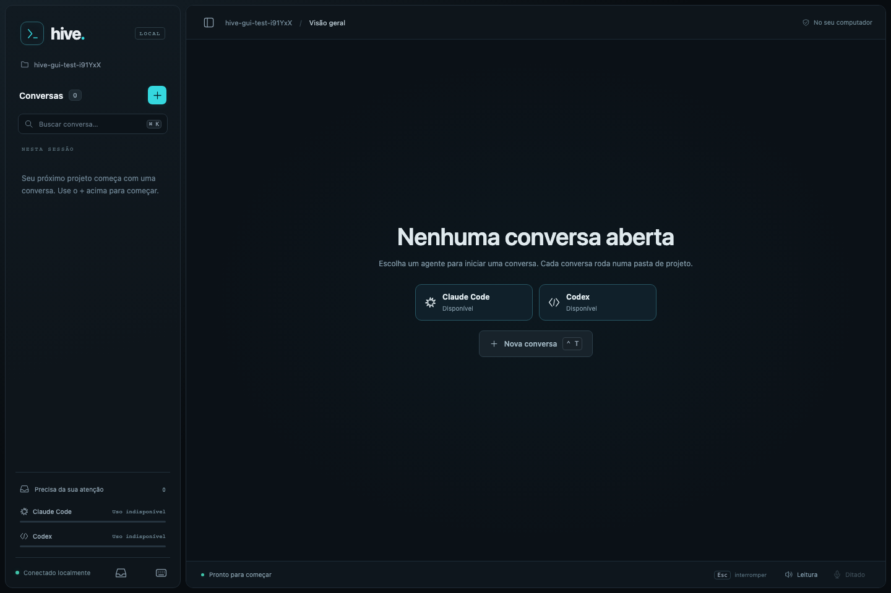
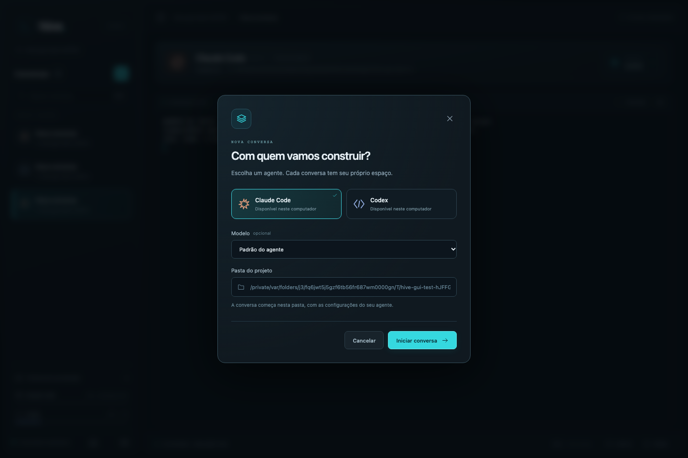
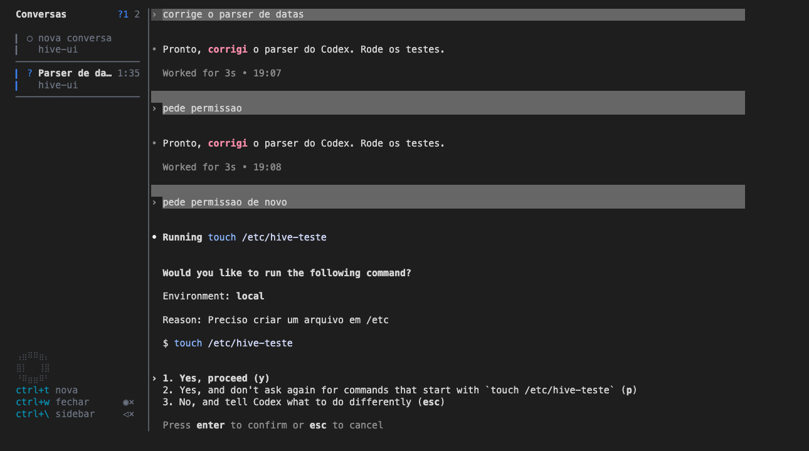

# hive-ui

Interface local para o [Claude Code](https://claude.com/claude-code) e o Codex, com janela própria, barra lateral de conversas, modelos e terminal integrado. O modo terminal continua disponível; o visual e várias funções do sidebar se inspiram no [workmux](https://github.com/raine/workmux).


- Digitar `hive` abre o aplicativo Hive em uma janela própria, sem abrir o navegador.
- `hive --terminal` abre a interface dentro do terminal.
- Cada conversa executa um agente real; escolher uma no sidebar a traz para a área principal sem perder o estado das outras.
- A lista de conversas é da sessão: fechar a janela do aplicativo encerra os processos dela. No modo terminal, fechar o terminal encerra a sessão.
- `claude` continua abrindo o Claude Code puro, sem a interface.

## Sumário

- [Instalação](#instalação)
- [Modelos de voz e ditado](#modelos-de-voz-e-ditado)
- [Primeiro uso](#primeiro-uso)
- [Interface gráfica](#interface-gráfica)
- [Funcionalidades](#funcionalidades)
- [Atalhos](#atalhos)
- [Claude Code puro](#claude-code-puro)
- [Problemas comuns](#problemas-comuns)
- [Desinstalar](#desinstalar)
- [Como funciona](#como-funciona)

## Interface gráfica

Para abrir a interface com botões, cartões e menus em uma janela própria:

```sh
hive
```

`hive --gui` continua funcionando como alias, e `npm run gui` abre o mesmo aplicativo dentro do repositório. Depois de atualizar o projeto, rode `npm install` para instalar o runtime da janela e o terminal integrado.



- O **+** abre a escolha entre Claude Code e Codex, com modelo opcional e pasta de trabalho. Um agente instalado é suficiente para usar este modo.
- Cada conversa executa o agente real em sua própria sessão tmux. Trocar de cartão preserva o processo, a tela e o rascunho. O terminal integrado aceita texto, atalhos, seleção e permissões como o agente original.
- O cabeçalho identifica agente, versão do aplicativo, modelo, plano e pasta. O botão de modelo abre outra conversa e mantém a atual. Sem dado do agente, o modelo fica em identificação; aliases não presumem uma versão específica.
- A sidebar oferece busca, status, contadores de alterações, uso dos planos e o botão para ir à próxima conversa pendente. A seta do cabeçalho esconde e mostra a sidebar.
- **Leitura** e **Ditado** reaproveitam os recursos locais de voz do modo terminal. O ditado preenche o terminal sem enviar a mensagem. Os modelos são baixados apenas ao ligar cada recurso.
- O ícone de notificações no rodapé da sidebar permite ativar os avisos do aplicativo. Use o ícone de teclado para consultar os atalhos.



A janela própria usa Electron e carrega os arquivos locais do projeto. O serviço interno escuta apenas em `127.0.0.1`, com uma chave temporária por execução; nenhuma aba é aberta no Chrome ou no navegador padrão. **Fechar a janela ou sair do aplicativo encerra o serviço e suas conversas.** `Ctrl-C` no terminal que abriu o Hive também encerra tudo. Para usar a interface antiga dentro do terminal, execute `hive --terminal`.

Atualmente, o launcher mantém o prompt ocupado e o aplicativo ainda depende do terminal de origem. O desacoplamento está [registrado para implementação futura](docs/launcher-desacoplado.md) na issue #55; mantenha esse terminal aberto enquanto usa o Hive.

Para desenvolvimento, `npm run gui:web` permite abrir a mesma interface no navegador; esse modo não é usado pelo comando `hive`.

Testes: `npm run test:gui` executa o Chromium e a janela Electron com agentes falsos, verificando conversas, rascunho, modelos, hooks, busca e encerramento. `npm run test:launcher` verifica o comando padrão e seus aliases. Na primeira execução de desenvolvimento, instale o navegador com `npx playwright install chromium`. `npm test` verifica o modo terminal.

## Instalação

### 1. Requisitos

- macOS ou Linux, com zsh ou bash
- [tmux](https://github.com/tmux/tmux) 3.x
- [Node](https://nodejs.org) 22.12+ (requisito do runtime desktop)
- [Claude Code](https://claude.com/claude-code) instalado e logado
- Opcional, só para as [conversas do Codex](#conversas-do-codex): o [Codex](https://github.com/openai/codex) instalado e logado (`npm i -g @openai/codex` e `codex login`)
- Opcional, só para o [ditado por voz](#ditado-por-voz): um gravador de áudio. No macOS, o [ffmpeg](https://ffmpeg.org) ou o `sox`; no Linux, o `parec` (pulseaudio-utils), o `pw-record` (pipewire), o `arecord` (alsa-utils), o `ffmpeg` ou o `sox`.
- Só no Linux, para baixar a voz e o modelo do ditado: `bzip2`.

Confira se estão no PATH:

```sh
tmux -V           # tmux 3.x
node -v           # v20 ou maior
claude --version  # Claude Code
ffmpeg -version   # opcional, para o ditado
```

No macOS, o que faltar sai pelo Homebrew: `brew install tmux node ffmpeg`.

### 2. Clone e instale

```sh
git clone https://github.com/ghts2110/hive-ui.git ~/hive-ui
cd ~/hive-ui && npm install && npm link
```

O `npm install` também traz o [sherpa-onnx](https://github.com/k2-fsa/sherpa-onnx), que roda a voz da leitura em voz alta e o reconhecimento do ditado no próprio computador. Os modelos em si só são baixados quando você liga cada função (ver [Modelos de voz e ditado](#modelos-de-voz-e-ditado)).

### 3. Comando `hive`

O `npm link` já criou o comando: abra um terminal novo e digite `hive`. Não precisa mexer no `~/.zshrc` (ou `~/.bashrc`). O `claude` não é tocado: continua abrindo o Claude Code puro.

O comando aponta para a pasta clonada, então um `git pull` já atualiza a interface; só rode `npm install` de novo se as dependências mudarem. Com o nvm, o comando fica preso à versão do Node em que o `npm link` rodou: trocando de versão (`nvm use`), rode `npm link` de novo na pasta.

**Vindo de uma versão antiga?** Antes a interface abria por uma função `claude() { ... }` ou por um `alias hive=...` no `~/.zshrc` (ou `~/.bashrc`). Apague-os, rode o `npm link` acima e abra um terminal novo: o `source ~/.zshrc` não remove uma função já carregada (no terminal atual, `unfunction claude` no zsh ou `unset -f claude` no bash).

### 4. Permissões e ajustes do macOS

Nada disso é necessário para usar o sidebar; só para o ditado e o aviso sonoro.

- **Microfone (ditado por voz):** na primeira vez que o ditado é ligado, o macOS pergunta se o Terminal pode usar o microfone; aceite. Se negou antes, libere o Terminal em Ajustes do Sistema > Privacidade e Segurança > Microfone e reabra o Terminal.
- **Som e Dock (aviso quando uma conversa termina):** o aviso é o sino do terminal, não uma notificação do sistema, então não há permissão de notificações a dar. No Terminal.app, em Ajustes > Perfis > Avançado, seção Sino, deixe marcados "Sino audível" e "Fazer ícone do app pular quando em 2º plano" no perfil que você usa. Sem som com a opção marcada, confira o volume de alertas em Ajustes do Sistema > Som.
- **Voz do sistema (opcional):** a leitura em voz alta usa uma voz própria; a do sistema só entra enquanto ela baixa ou se o download falhar. Para tê-la, instale uma voz em português do Brasil em Ajustes do Sistema > Acessibilidade > Conteúdo Falado > Voz do Sistema > Gerenciar Vozes.

## Modelos de voz e ditado

A leitura em voz alta e o ditado rodam no próprio computador: funcionam offline e não gastam tokens. Para isso, cada um baixa um modelo na primeira vez que é ligado, nunca antes. O sidebar mostra o download no rodapé ("baixando voz natural…", "baixando ditado 42%") e a conversa continua usável enquanto isso.

| Função | Modelo | Baixado quando | Download | Em disco |
| --- | --- | --- | --- | --- |
| Leitura em voz alta | [Piper pt_BR faber](https://huggingface.co/rhasspy/piper-voices/tree/main/pt/pt_BR/faber/medium) | a leitura é ligada pela primeira vez | ~67 MB | ~80 MB |
| Ditado por voz | [Whisper turbo](https://github.com/openai/whisper) e detector de fala Silero | o microfone é ligado pela primeira vez | ~540 MB | ~1 GB |

Os dois ficam em `~/.cache/hive-ui` (ou `$XDG_CACHE_HOME/hive-ui`), uma pasta por modelo. No modo terminal, são os únicos arquivos que o hive-ui grava fora do repositório. A janela desktop também usa os diretórios técnicos e de cache do Electron; a lista de conversas permanece apenas na sessão. Apagar a pasta remove os modelos; eles são baixados de novo na próxima vez que a função for ligada. Um download interrompido (terminal fechado no meio) não deixa um modelo pela metade: recomeça do zero na próxima vez.

No Linux, extrair os modelos precisa do `bzip2`. Os modelos rodam em macOS e Linux, Intel e ARM; em outra plataforma, a leitura usa a voz do sistema e o ditado fica indisponível.

## Primeiro uso

`hive` abre a janela do aplicativo. Clique em **+** para escolher o agente, o modelo e a pasta.

Para usar a interface no terminal, abra com `hive --terminal`. Os passos e atalhos abaixo descrevem esse modo. Argumentos continuam sendo repassados ao agente (`hive --terminal --continue`, `hive --terminal "corrige o teste"`); chamadas antigas com argumentos (`hive --continue`) também continuam compatíveis.


- **Criar:** `Ctrl-T`, de qualquer lugar, abre uma conversa nova e a traz para a tela. Com o sidebar focado, `c` abre uma do [Codex](#conversas-do-codex).
- **Alternar:** `Ctrl-\` leva o foco ao sidebar; escolha com `↑`/`↓` e `Enter` (ou clique). As que não estão na tela continuam rodando.
- **Fechar:** `Ctrl-W` fecha a conversa da tela (confirma com `s`) e põe a vizinha no lugar; na última, abre uma nova. `/exit` também fecha a conversa e, na última, encerra a interface.
- **Ditar e ouvir:** `Ctrl-Q` liga o microfone; o alto-falante no rodapé do sidebar liga a leitura em voz alta.
- **Ajuda:** com o sidebar focado, `?` lista os atalhos.

Fechar o terminal encerra tudo: as conversas, o sidebar e o tmux por trás deles.

## Funcionalidades

### Conversas do Codex



Com o sidebar focado, `c` abre uma conversa nova com o [Codex](https://github.com/openai/codex) no lugar do Claude Code. Ela fica na lista junto das outras e tem o mesmo comportamento: troca sem perder estado, status, título, aviso com som e no Dock, ditado e leitura em voz alta. O título é o nome que o Codex dá à conversa ou, até ele dar um, a sua primeira mensagem. O cabeçalho acompanha o agente da conversa e mostra versão, modelo e plano quando disponíveis. As linhas mudadas continuam sendo informadas apenas pelo Claude Code.

O status vem dos hooks do Codex, passados só para essa conversa: nada é gravado no `~/.codex`. Sem o Codex instalado, o `c` mostra como instalar. `codex` digitado no terminal continua abrindo o Codex puro.

### Status de cada conversa


A faixa e o ícone à esquerda mostram o status: `✓` verde quando o Claude terminou, `?` azul quando precisa de você (pergunta, permissão ou aprovação), spinner amarelo enquanto trabalha e `○` antes da primeira mensagem. Ao lado, há quanto tempo está nesse status. `Esc` ou `Ctrl-C` no meio de uma resposta passam a conversa para pronta.

### Título, pasta e linhas mudadas

O título é o assunto que o Claude Code dá à conversa (o mesmo do título do terminal). Até ele dar um assunto, o título é a sua primeira mensagem; antes dela, "nova conversa". `/clear` volta ao provisório.

Embaixo, a pasta da conversa e as linhas que o Claude adicionou e removeu nela com as ferramentas de edição (`+12 -3`), contadas por conversa: duas conversas no mesmo repositório mostram cada uma as suas, e uma que não editou nada não mostra contador. É o acumulado das edições, não o saldo contra o último commit: editar a mesma linha duas vezes conta duas, e mudanças feitas por comandos no terminal ficam de fora. `/clear` zera o contador.

### Novidades fora da tela

Conversa que termina ou passa a esperar por você fora da tela fica em negrito até ser aberta. O topo do sidebar conta quantas esperam (`?1`), quantas terminaram sem ser vistas (`✓2`) e o total. `p` pula para a próxima pendente.

### Aviso com som e no Dock

Quando qualquer conversa termina a resposta ou passa a esperar por você, o terminal recebe um sino: o Mac apita e, se o Terminal estiver em segundo plano, o ícone dele pula no Dock. Vale também para as conversas fora da tela. Só a mudança avisa: uma conversa que continua pronta ou esperando não apita de novo, e interromper com `Esc` ou `Ctrl-C` não apita. O ajuste do Terminal.app para isso está em [Permissões e ajustes do macOS](#4-permissões-e-ajustes-do-macos).

### Troca sem perder estado


Trocar de conversa só muda qual `claude` ocupa a área principal: nenhum processo é reiniciado, e uma pergunta pendente continua lá quando você volta. `Tab` volta para a conversa anterior e `1`-`9` abrem a conversa daquela posição.

### Cabeçalho fixo

O cabeçalho de três linhas fica sempre acima da conversa, com símbolo e versão do agente, modelo, plano (quando disponível) e pasta. Ele acompanha a conversa ao alternar entre Claude Code e Codex.

O botão **[+]** ao lado de “Conversas”, na barra lateral, abre as opções **Claude Code** e **Codex**. Clique no agente para iniciar uma conversa na pasta atual. Pelo teclado, `+` ou `a` abre o seletor, `↑`/`↓` escolhe, `Enter` confirma e `Esc` cancela. Os atalhos `n`, `c` e `Ctrl-T` continuam disponíveis.

O cabeçalho separa a versão do aplicativo (ao lado do nome do agente) do modelo em uso, exibido na segunda linha. Sem informação do agente, mostra “aguardando identificação…” em vez de presumir um modelo ou uma versão.

Clique no botão **[ Trocar modelo ▾ ]**, à direita do cabeçalho, para abrir as opções. Pelo teclado, use `Ctrl-]` e `m`. No Claude, escolha Padrão, Opus, Sonnet, Haiku ou Outro ID; no Codex, Padrão, o modelo identificado ou Outro ID. As opções são aliases, sem presumir versões específicas ou disponibilidade na conta. Use `←`/`→`, `Enter` ou clique; `i` permite informar o ID diretamente e `Esc` cancela.

Confirmar um modelo abre **uma nova conversa na mesma pasta**, preservando a anterior com seu processo, histórico e rascunho. O seletor informa esse comportamento antes da confirmação. O modelo escolhido vale apenas para a nova conversa; sua disponibilidade é validada pelo próprio agente. Nenhuma configuração global é alterada.

### Uso do plano

No rodapé do sidebar, um anel enche em laranja conforme a janela de 5h do plano Pro/Max é consumida. Com o mouse em cima, ou depois de um clique nele, aparecem a % usada e a hora em que a janela reinicia. O dado vem da statusline do Claude Code, então só muda quando alguma conversa do hive-ui recebe resposta; antes disso, ou com login por API, o anel fica apagado. Se você tem uma statusline própria, ela continua aparecendo.

### Leitura em voz alta

O alto-falante no canto de baixo do sidebar (ou `v`, com o sidebar focado) liga a leitura: cada texto que o Claude escreve na conversa da tela é falado assim que ele termina aquele trecho, sempre o mais recente; o que já estava escrito antes de ligar não é lido. Blocos de código, diffs, tabelas, links e saídas de comando ficam de fora. Um texto novo, uma mensagem sua, `Esc` ou `Ctrl-C` calam a fala; as conversas em segundo plano ficam em silêncio. Começa desligada.

A voz é a Piper pt_BR faber, gerada no próprio computador pelo sherpa-onnx, e começa a falar meio segundo depois do texto. Na primeira vez, ela é baixada (ver [Modelos de voz e ditado](#modelos-de-voz-e-ditado)). Enquanto baixa, ou se o download falhar, a leitura usa a voz pt-br do sistema (`say` no macOS, `espeak-ng` no Linux) e tenta baixar de novo na próxima vez que for ligada. Sem nenhuma das duas, o sidebar mostra como instalar a do sistema.

### Ditado por voz


O microfone no rodapé do sidebar, logo acima do alto-falante (ou `Ctrl-Q` de qualquer lugar, ou `m` com o sidebar focado), liga o ditado: o que você fala vai sendo digitado no campo de mensagem da conversa da tela, uma frase de cada vez, a cada pausa. Nada é enviado sozinho: revise, corrija se precisar e aperte `Enter`.

- **Parar:** clicar de novo, `Ctrl-Q` ou `m` param de ouvir (o que já foi dito ainda é digitado). Enviar a mensagem e 20 segundos sem fala também param.
- **Escolhas:** se a conversa está esperando uma escolha sua (permissão, pergunta), o que você ditar fica guardado até o campo de mensagem voltar, para nenhuma palavra ser tomada como resposta da escolha.
- **Enquanto ouve:** o ícone fica vermelho, as ondas pulsam com a sua voz e a leitura em voz alta fica muda, para o ditado não transcrever a voz do Claude.

O ditado usa o Whisper turbo, o modelo aberto de reconhecimento de voz da OpenAI, rodando no próprio computador pelo sherpa-onnx: entende termos em inglês no meio do português ("abre um pull request"). Na primeira vez, o modelo é baixado, com o progresso no rodapé (ver [Modelos de voz e ditado](#modelos-de-voz-e-ditado)). Ouvir o microfone precisa de um gravador (ver [Requisitos](#1-requisitos)) e, no macOS, do [acesso do Terminal ao microfone](#4-permissões-e-ajustes-do-macos); faltando algum, o sidebar diz o que fazer.

### Sidebar ajustável

`h` esconde o sidebar e a conversa ocupa o terminal inteiro; `Ctrl-\` o traz de volta. `<` e `>` estreitam e alargam o sidebar, e arrastar a borda com o mouse também vale. A largura se mantém ao redimensionar o terminal, até metade dele. A borda do pane com o foco fica em ciano, então dá para ver se as teclas vão para o sidebar ou para a conversa.

### Mac acordado

No macOS, enquanto a interface estiver aberta, o Mac não entra em repouso e a tela não apaga por inatividade, então dá para acompanhar uma tarefa longa sem ela parar no meio. Fechar a tampa continua pondo o Mac para dormir. Quando a sessão acaba, inclusive com o terminal fechado ou num crash, tela e repouso voltam ao comportamento normal (é o `caffeinate` do sistema, preso ao processo do tmux).

## Atalhos


| Tecla | Onde | Ação |
| --- | --- | --- |
| `Ctrl-\` | qualquer lugar | alterna o foco entre o sidebar e a conversa; com o sidebar escondido, o traz de volta |
| `Ctrl-T` | qualquer lugar | conversa nova |
| `Ctrl-W` | qualquer lugar | fecha a conversa da tela (confirma com `s`) |
| `Ctrl-Q` | qualquer lugar | liga / desliga o ditado por voz |
| `Esc`, `Ctrl-C` | qualquer lugar | calam a fala em andamento (e chegam ao Claude Code como sempre) |
| `↑`/`↓`, `j`/`k` | sidebar | escolhe a conversa |
| `g`/`G` | sidebar | vai ao início e ao fim |
| `Enter`, clique | sidebar | traz a conversa para a tela (a rodinha do mouse move a seleção) |
| `1`-`9` | sidebar | abre a conversa daquela posição |
| `Tab` | sidebar | volta para a conversa anterior |
| `p` | sidebar | próxima pendente: a que passou a esperar por você ou terminou sem ser vista, depois as que continuam esperando |
| `n` / `x` | sidebar | conversa nova / fecha a selecionada (pede confirmação) |
| `c` | sidebar | conversa nova do Codex |
| `a` | sidebar | abrir seletor de agentes |
| `Ctrl-]` | qualquer pane | focar cabeçalho |
| `h` | sidebar | esconde o sidebar |
| `<` / `>` | sidebar | estreita / alarga o sidebar (ou arraste a borda) |
| `v`, clique no alto-falante | sidebar | liga / desliga a leitura em voz alta |
| `m`, clique no microfone | sidebar | liga / desliga o ditado por voz |
| clique no anel | sidebar | mostra a % usada do plano e quando a janela reinicia |
| `?` | sidebar | mostra os atalhos (`?`, `q` ou `Esc` fecham) |
| `Esc` | sidebar | volta para a conversa |

Fora `Ctrl-\`, `Ctrl-T`, `Ctrl-W` e `Ctrl-Q` (e `Esc`/`Ctrl-C`, que calam a fala e seguem chegando ao Claude Code), os atalhos só valem com o sidebar focado, então os do Claude Code continuam chegando a ele. Esses quatro deixam de chegar ao Claude Code dentro da interface (o `Ctrl-W` não apaga mais a palavra anterior no prompt). O prefixo do tmux fica desligado (`Ctrl-b` chega ao Claude Code) e `Ctrl-Z` fica desativado: suspenderia o claude sem um shell para trazê-lo de volta.

## Claude Code puro

A interface sempre deixa uma saída para o Claude Code sem nada em volta:

- `claude` abre sempre o Claude Code puro, sem a interface: o hive-ui não o intercepta.
- Rodar `hive --terminal` dentro da interface (ou de qualquer tmux) abre o Claude Code puro. O comando simples `hive` abre o aplicativo próprio.
- Com o `hive`, modos não interativos e subcomandos (`-p`, `--version`, `--help`, `mcp`, `update`, `doctor`, ...) e uso em pipes ou scripts rodam o Claude Code puro, para a saída não sumir com o tmux.

## Problemas comuns

### Ao abrir

| Mensagem | Causa e solução |
| --- | --- |
| `hive: tmux não encontrado. Instale com 'brew install tmux'` | tmux ausente ou fora do PATH. Instale (`brew install tmux`, `apt install tmux`) e abra um terminal novo. |
| `hive: Node não encontrado. Instale o Node 22.12+` | Node ausente ou fora do PATH. Confira `command -v node` num terminal novo; com nvm carregado sob demanda (lazy load), carregue-o no início do shell ou rode `nvm alias default 22`. |
| `hive: dependências faltando. Rode 'npm install' em ...` | Faltou o passo 2: rode `npm install` na pasta clonada. |
| `hive: Claude Code não encontrado no PATH.` | O binário `claude` não está no PATH. Instale o Claude Code e confira com `command -v claude`. |
| `zsh: command not found: hive` | Faltou o `npm link` na pasta clonada, ou ele rodou em outra versão do Node (nvm). Rode `npm link` na pasta e abra um terminal novo. |
| `no such file or directory: .../bin/claude-ui` ao digitar `claude` | Sobrou a função `claude()` da versão antiga. Veja "Vindo de uma versão antiga?" no passo 3. |
| `no such file or directory: .../bin/hive` (zsh) ou `.../bin/hive: No such file or directory` (bash) | Sobrou um `alias hive=...` antigo no `~/.zshrc` (ou `~/.bashrc`) apontando para outro lugar. Apague-o e abra um terminal novo. |

### No sidebar

| Sintoma | Causa e solução |
| --- | --- |
| Conversa sem título e sem status | Título e status vêm de hooks do Claude Code passados com `--settings` (ver `sidebar/hooks.json`). Passar outro `--settings` ou desligar hooks nas suas configurações os desativa. |
| Anel do uso do plano sempre apagado | Ele só acende depois que uma conversa do hive-ui recebe resposta, e não aparece com login por API. |
| Nenhum som quando uma conversa termina | Confira o sino do perfil do Terminal.app e o volume de alertas (ver [Permissões e ajustes do macOS](#4-permissões-e-ajustes-do-macos)). |
| "sem voz natural: usando a do sistema" | O download da voz falhou (sem internet, sem `bzip2` no Linux). A leitura segue com a voz do sistema e tenta baixar de novo na próxima vez que for ligada. |
| "Sem voz em português do Brasil." | Sem a voz natural e sem voz pt-br no sistema. Instale uma em Ajustes do Sistema > Acessibilidade > Conteúdo Falado > Voz do Sistema > Gerenciar Vozes (Linux: `sudo apt install espeak-ng`). |
| "Sem gravador de áudio." | Instale o `ffmpeg` (`brew install ffmpeg`); no Linux, `pulseaudio-utils`, `pipewire` (`pw-record`) ou `alsa-utils`. Depois clique no microfone de novo. |
| "Sem acesso ao microfone." | Libere o Terminal em Ajustes do Sistema > Privacidade e Segurança > Microfone e reabra o Terminal. Se já está liberado, confira o volume de entrada em Ajustes do Sistema > Som > Entrada. |
| "sem ditado: o download falhou" | Sem internet ou sem `bzip2` no Linux. Clique no microfone para tentar de novo. |
| "o ditado falhou: clique para tentar" | O modelo não abriu (por exemplo, arquivo corrompido em `~/.cache/hive-ui`). Clique no microfone para tentar de novo; se repetir, apague a pasta do modelo para ele ser baixado outra vez. |
| "silêncio longo: parei de ouvir" | 20 segundos sem fala desligam o microfone. Ligue de novo quando for falar. |

Enquanto não resolve, `claude` abre o Claude Code puro.

## Desinstalar

1. Remova o comando: `npm rm -g hive-ui`. Se ainda houver um `alias hive=...` ou a função antiga `claude() { ... }` no `~/.zshrc` (ou `~/.bashrc`), apague-os e abra um terminal novo.
2. Apague a pasta clonada: `rm -rf ~/hive-ui`.
3. Apague os modelos da leitura em voz alta e do ditado, se foram baixados: `rm -rf ~/.cache/hive-ui`.
4. Opcional: tire o acesso do Terminal ao microfone em Ajustes do Sistema > Privacidade e Segurança > Microfone, se só o liberou para o ditado.

Não sobra mais nada: o modo terminal não salva outros arquivos fora do repositório e cada sessão do tmux morre com o terminal. O aplicativo desktop também pode deixar cache técnico do Electron nos diretórios do sistema.

## Como funciona

- **tmux** cuida do layout e mantém cada conversa viva em seu próprio pane; trocar de conversa troca qual pane ocupa a área principal. Cada terminal tem seu próprio servidor tmux, com a config do repo (`tmux.conf`); o `~/.tmux.conf` não é lido.
- **Node + [Ink](https://github.com/vadimdemedes/ink)** desenha o sidebar, que conversa com o tmux pela linha de comando.
- **Hooks e statusline do Claude Code** avisam o sidebar quando uma conversa muda de status, ganha título ou edita arquivos, e trazem o uso do plano. Nas conversas do Codex, os hooks dele fazem o mesmo papel no status.
- **[sherpa-onnx](https://github.com/k2-fsa/sherpa-onnx)** roda a voz da leitura e o reconhecimento do ditado localmente.
- O `hive` é um link, criado pelo `npm link`, para o launcher do projeto (`bin/hive`). Sem argumentos, abre a janela Electron e o serviço local em processos separados. O terminal e a voz usam o Node do usuário. Fechar a janela encerra o serviço e o servidor tmux privado. O `claude` em si não é interceptado.
- `hive --terminal` mantém o layout tmux e a sidebar Ink.

Testes do launcher: `npm test`.

## Licença

[MIT](LICENSE)
